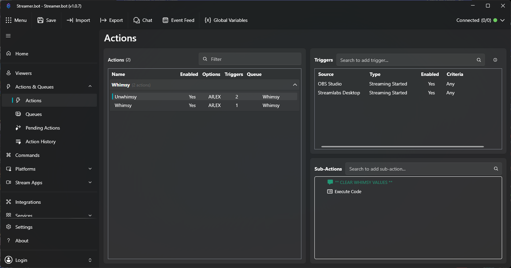

# SB-Whimsy



Streamer.bot code, to have a whimsy as a command.

- It will roll a random number between 0 and 100%
- It will remember the users roll and has global persist on highest value and the users who rolled it.
- Using the `Unwhimsy.cs` in the OBS start will unset the high score for new start.
    - **NOTE** Change this to keybind if you want.

# Configure
You can change what the message contains, by adjusting the `outputMsg` variable in the `Whimsy.cs` or through the Streamerbot edit sub-action

## Line and what the message is for

```
Line 37     The user has a whimsy score already.
Line 51     The first user to use whimsy, automatically the whimsiest.
Line 60     The user became the most whimsiest.
Line 69     The user tied for the most whimsiest.
Line 79     The user didn't become the whimsiest. This option is worded 
            for when there is only one person with highest whimsy
Line 85     Same as line 79, but only when there are 2 or more users with
            highest whimsy score.
```